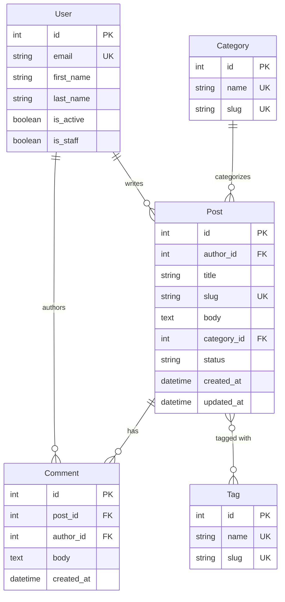
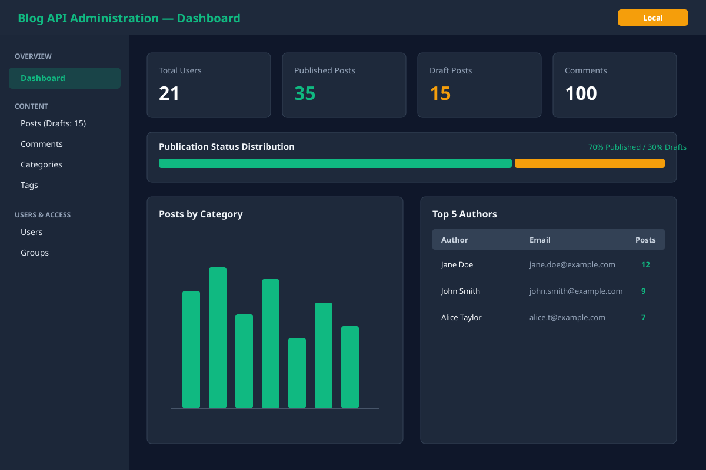

# Blog API

A modern blog REST API and administration platform built with Django and Django Unfold.

## Entity-Relationship Diagram (ERD)




---

## Seeding Fake Data

The project includes a bulk management command to populate the database with realistic fake data.

```bash
python manage.py seed [options]
```

### Arguments

| Argument | Default | Description |
| :--- | :--- | :--- |
| `--users` | `20` | Number of users to generate |
| `--posts` | `100` | Number of posts to generate |
| `--comments` | `500` | Number of comments to generate (on published posts) |
| `--clear` | off | Delete existing data before seeding (preserves superusers) |

### Example

```bash
python manage.py seed --users 50 --posts 300 --comments 1500
```

Output:
```text
Users:         50 created
Categories:     8 created
Tags:          20 created
Posts:        300 created
Comments:    1500 created
Done in 2.14 seconds
```

---

## Admin Panel (Django Unfold)

The administration interface is styled using **Django Unfold**:

- **Custom Theme**: Emerald primary palette, dark/light theme, environment badge (`Local` / `Production`).
- **Dashboard**:
  - Metric cards: total users, published posts, draft posts, comments.
  - Category bar chart: number of posts per category.
  - Author ranking table: top 5 contributors by post count.
  - Progress bar: share of published vs draft posts.
- **Advanced Features**:
  - Tabbed editing forms (`Content`, `Classification`, `Meta` fieldsets).
  - Row expansion (`TableSection`) to inspect category posts and post comments.
  - Inlines with pagination (`10 per page`) and tab view.
  - Quick actions (row actions, list actions, submit line actions, bulk publish/draft).
  - Autocomplete filters, date ranges, and zero N+1 queries.

### Dashboard Preview



---

## Project Structure

```text
├── manage.py
├── requirements/
│   ├── base.txt       # Shared dependencies (Django, Unfold, DRF)
│   ├── dev.txt        # Development dependencies (Faker, Ruff, django-extensions)
│   └── prod.txt       # Production dependencies (PostgreSQL, Gunicorn)
├── logs/              # Log files (gitignored)
├── apps/
│   ├── auths/         # Custom User model & auth
│   └── blog/          # Posts, comments, categories, tags & seed command
├── settings/
│   ├── .env           # Environment secrets (gitignored)
│   ├── .env.example   # Example environment variables
│   ├── conf.py        # Decouple config loader
│   ├── base.py        # Shared settings & Unfold configuration
│   ├── urls.py
│   ├── wsgi.py
│   ├── asgi.py
│   └── env/
│       ├── local.py   # Local dev settings (SQLite, DEBUG=True)
│       └── prod.py    # Production settings (PostgreSQL, DEBUG=False)
├── templates/
│   └── admin/
│       └── index.html # Custom Unfold dashboard
└── docs/
    ├── erd.svg
    └── screenshots/
        └── dashboard.svg
```

---

## Setup & Local Run

1. Activate virtual environment:
   ```bash
   source venv/bin/activate
   ```

2. Install dependencies:
   ```bash
   pip install -r requirements/dev.txt
   ```

3. Configure environment variables in `settings/.env`:
   ```bash
   cp settings/.env.example settings/.env
   ```

4. Apply migrations:
   ```bash
   python manage.py migrate
   ```

5. Seed database:
   ```bash
   python manage.py seed
   ```

6. Create an admin user:
   ```bash
   python manage.py createsuperuser
   ```

7. Run development server:
   ```bash
   python manage.py runserver
   ```

Admin panel is available at: [http://127.0.0.1:8000/admin/](http://127.0.0.1:8000/admin/)
