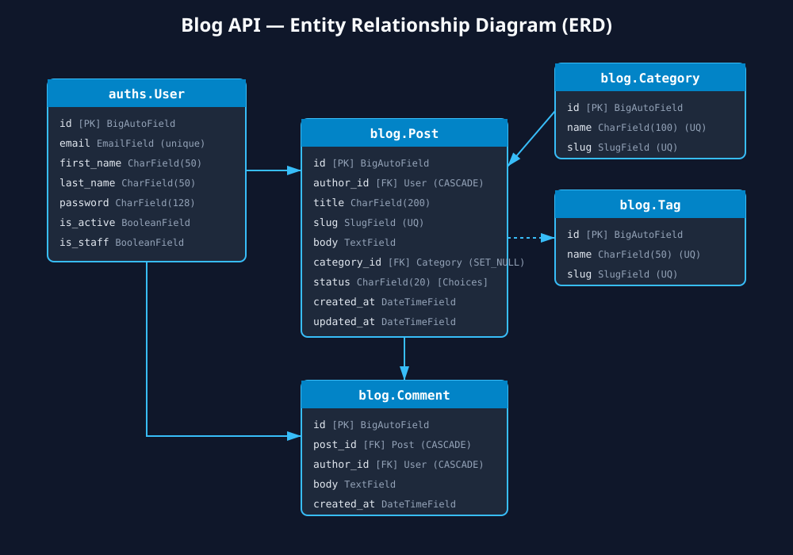
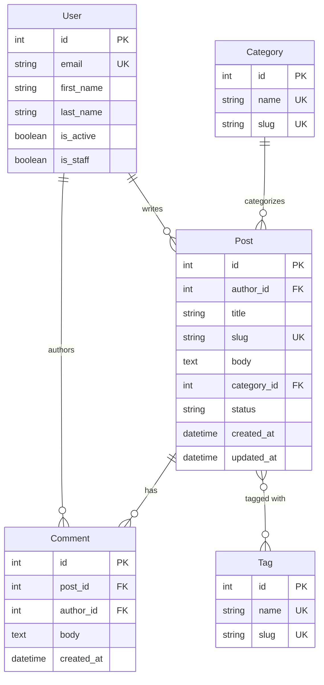

# Blog API

A blog REST API built with Django.

## Entity-Relationship Diagram (ERD)





## Project Structure

```text
├── manage.py
├── requirements/
│   ├── base.txt
│   ├── dev.txt
│   └── prod.txt
├── logs/
├── apps/
│   ├── auths/
│   └── blog/
├── settings/
│   ├── .env
│   ├── .env.example
│   ├── conf.py
│   ├── base.py
│   ├── urls.py
│   ├── wsgi.py
│   ├── asgi.py
│   └── env/
│       ├── local.py
│       └── prod.py
└── docs/
    └── erd.svg
```

## Setup & Local Run

1. Activate virtual environment:
   ```bash
   source venv/bin/activate
   ```

2. Install dependencies:
   ```bash
   pip install -r requirements/dev.txt
   ```

3. Configure environment variables in `settings/.env`:
   ```bash
   cp settings/.env.example settings/.env
   ```

4. Apply migrations:
   ```bash
   python manage.py migrate
   ```

5. Run development server:
   ```bash
   python manage.py runserver
   ```
